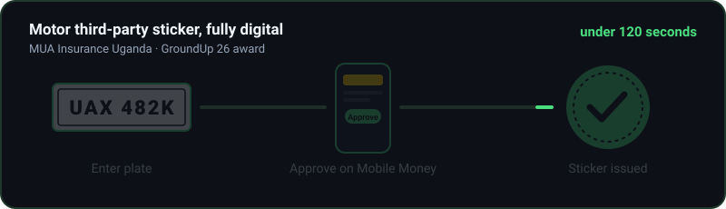

 

 

&nbsp;

&nbsp;

&nbsp;

&nbsp;

---

###  About

I build the systems institutions run on: insurance, lending, education and payments, designed for East Africa's real constraints (Mobile Money first, patchy connectivity, regulated data).

Co-founder of **[Synsify Africa](https://synsify.africa)**, Uganda's digital product studio, and builder of **Soma** and **Wola**. I got into tech because I love to create, and because I'm "lazy" in the useful way: if a task is repetitive, it should be automated.

---

### 🏆 Recognition

**MUA GroundUp 26 Award** for the **MUA Third-Party Digital Sticker**, built with Emmanuel Lulu Chaciga.
Plate number → Mobile Money approval → motor third-party sticker issued, **in under 120 seconds**.

---

### 🚀 What I'm Building

<table>
<tr>
<td width="50%" valign="top">

#### 🎓 Soma · Education
School admissions platform for Uganda, connecting parents with schools across the country, built for low-bandwidth, Mobile Money-first realities.

`🟢 Active development`

</td>
<td width="50%" valign="top">

#### 💰 Wola · Fintech SaaS
Multi-tenant staff loan platform for SACCOs and employers. Amortisation engine verified against real institutional schemes; tenant isolation enforced with Postgres Row-Level Security from day one.

`🟢 Active development`

</td>
</tr>
<tr>
<td width="50%" valign="top">

#### 🛡️ MUA Insurance Uganda · Enterprise
Systems work inside a regulated insurer: the award-winning digital sticker flow, plus an access-management system for meals and parking with audit trails, scheduled digests and backfill tooling.

`🔵 Live`

</td>
<td width="50%" valign="top">

#### 📊 NIC Life · Insurance Reporting
Dashboard rebuild for NIC Life Assurance: full frontend redesign and a re-architected aggregation layer for policy, claims and actuarial reporting.

`🟠 In delivery`

</td>
</tr>
</table>

---

### 🤝 Selected Client Work (via Synsify)

| Client | Sector | What we shipped |
|---|---|---|
| **Munno Ddala SACCO** | Fintech | Savings & credit cooperative system with member dashboards |
| **Rentbetahouse** 🇳🇬 | Proptech | Role-based rental platform, live listings, Paystack payments |
| **Kafunda Wines** | E-commerce | Online store with Pesapal payments and IPN handling |
| **Phoenix Advocates** | Legal | Firm website and case-management flows |
| **Kasirye Breeders** | Agriculture | Full-stack platform for a leading Ugandan livestock breeder |
| **Green World Safaris** | Tourism | Safari package booking experience |
| **Victoria View Boutique Hotel** | Hospitality | Booking and brand platform |

---

### 🛠️ Stack

 

 

---

### 📈 By the Numbers

| 5+ years | 12+ systems | 3 countries | 1 award |
|:---:|:---:|:---:|:---:|
| Building since 2021 | Shipped to production | 🇺🇬 🇳🇬 🇰🇪 | MUA GroundUp 26 |

---

### ⚡ GitHub Activity

---

### 🌍 Why East Africa

I'm not building for Silicon Valley. I'm building for Kampala and Nairobi, where the problems are real and much of the digital infrastructure doesn't exist yet.

My edge is having one foot inside institutions (regulated insurance, enterprise systems) and one in the open market (Soma, Wola, Synsify): **systems depth at founder speed**.

**Long-term:** a holding company that owns Soma, Wola and whatever comes next.

---

**Let's build something.** Open to partnerships, enterprise projects and conversations about tech in Africa.

<picture>
  <source media="(prefers-color-scheme: dark)" srcset="https://raw.githubusercontent.com/joshuakyayi256/joshuakyayi256/output/github-snake-dark.svg" />
  <source media="(prefers-color-scheme: light)" srcset="https://raw.githubusercontent.com/joshuakyayi256/joshuakyayi256/output/github-snake.svg" />
  
</picture>

